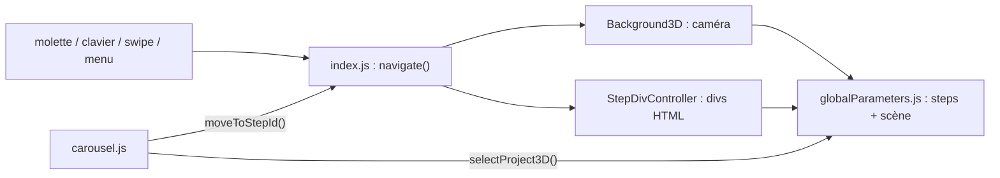

# Architecture

## Vue d'ensemble

Tout le contenu est écrit en dur dans `index.html` (et dans sa version anglaise, voir plus bas). Le JavaScript ne génère presque rien : il affiche une section à la fois, anime les transitions et pilote le fond 3D. Si WebGL est indisponible, le fond 3D est désactivé et le reste du site fonctionne normalement.

## Deux langues, deux pages

Le site existe en français (`index.html`, servi sous `/`) et en anglais (`en/index.html`, servi sous `/en/`). Les deux pages sont écrites à la main et ont **exactement la même structure** : seuls les textes, les attributs textuels (`title`, `alt`, `aria-label`…) et les liens externes (Wikipédia, Ableton) diffèrent. `tests/parity.test.js` le vérifie : mêmes ids, mêmes éléments et classes dans le même ordre (les balises de texte sans classe, `a`, `b`, `i`, `br`…, peuvent bouger), mêmes `src` et mêmes styles en ligne. **Toute modification de structure se fait donc dans les deux pages.**

- **Chemins absolus** (`/style.css`, `/dist/bundle.js`, `/assets/…`) dans les deux pages et dans le JS, pour qu'ils soient valables depuis `/` comme depuis `/en/`. Les tests refusent un chemin local relatif. Conséquence : la page ne s'ouvre pas en `file:///`, il faut la servir (`npm run dev`).
- **Le JS n'écrit aucun texte visible en dur** : il le lit dans la page. Seule chaîne aujourd'hui, le libellé du bouton retour des pages de détail, dans `data-back-label` de `#on_screen` (« Retour » / « Back »), lu par `src/carousel.js`. Une future chaîne suit la même règle (attribut `data-*` ou élément de la page), pas de dictionnaire dans le JS.
- **Référencement** : chaque `<head>` déclare son `canonical`, les trois `hreflang` (`fr`, `en`, et `x-default` vers la page française) et son `og:locale` avec l'autre langue en `og:locale:alternate`. Vérifié par `tests/site-integrity.test.js`.
- **CV** : la step `cv` de chaque page est le CV de sa langue ; son lien « Télécharger le PDF » / « Download PDF » pointe vers son impression (`CV_Valentin_Machado.pdf` / `CV_Valentin_Machado_EN.pdf`), et son lien `valentinmachado.github.io` vers la page de sa langue. Impression : « Le CV » dans DEPLOY.md.
- **Lien de langue** : `#language_link` (un `<a>`, il change de page), à droite du menu. `src/index.js` tient son `href` à jour à chaque step affichée (`/en/#cv`, `stepHash`, `src/utils.js`), et au chargement, un `location.hash` qui désigne une step connue (`stepIdFromHash`, `src/utils.js`) ouvre le site sur elle au lieu de `home`. Pas de redirection selon la langue du navigateur.
- **URL** : à chaque step affichée, `history.replaceState` récrit le hash de l'URL (`/#galeri3`, `/en/#cv`, rien pour `home` ; la query est gardée), pour qu'un rechargement ou un lien copié garde la step. `replaceState` et non `pushState` : l'historique ne garde qu'une entrée, « précédent » quitte le site. Un hash inconnu au chargement (`#nope`) est effacé ; un hash tapé dans la barre d'adresse après le chargement est sans effet (pas de `hashchange`).



## La notion de step

Une **step** est un écran du site. Elles sont toutes déclarées dans `globalParameters.steps` (`src/globalParameters.js`), une `Map` id → `Step` :

| Champ                                | Rôle                                                                                |
| ------------------------------------ | ----------------------------------------------------------------------------------- |
| `divId`                              | id de la `div.root_step` correspondante dans `index.html`                           |
| `cameraPosition`, `cameraTarget`     | point de vue de la caméra 3D pour cette step                                        |
| `nextStepId`, `previousStepId`       | voisines pour la molette, le clavier et le swipe (absentes sur les pages de détail) |
| `init`, `onFocus`, `onLeave`, `tick` | callbacks 3D optionnels, qui reçoivent la step en argument                          |

Il y a quatre steps principales chaînées (`home` → `projects` → `about` → `cv`) et une step par page de détail (`galeri3`, `souk`…). Les pages de détail partagent le même point de vue caméra et n'ont pas de voisines : on y entre depuis un carrousel et on en sort par le bouton retour ou le menu.

**L'ordre de déclaration dans la `Map` compte** : aller vers une step déclarée plus loin fait glisser l'écran vers le haut, vers une step déclarée avant, vers le bas.

## Modules

| Fichier                    | Rôle                                                                                                                                                                                                                                                                                                                                                                                    |
| -------------------------- | --------------------------------------------------------------------------------------------------------------------------------------------------------------------------------------------------------------------------------------------------------------------------------------------------------------------------------------------------------------------------------------- |
| `src/index.js`             | Point d'entrée (`window.onload`). Lit la step initiale dans le hash de l'URL, crée le fond 3D (optionnel), masque l'écran de chargement, branche la navigation (molette, clavier, swipe, menu, lien de langue, hash de l'URL), initialise les deux carrousels.                                                                                                                          |
| `src/globalParameters.js`  | Déclaration des steps et construction de la scène (`globalInit`) : 4 plateformes, leurs spots, et sur les deux plateformes des carrousels un modèle 3D par item ; la plateforme tourne pour mettre le modèle sélectionné face à la caméra, sous le spot. `globalTick` anime le décor à chaque frame, quelle que soit la step.                                                           |
| `src/carouselModels.js`    | Modèles low-poly des items des carrousels (maison, globe, diamant…), construits à partir de géométries three.js simples, un par id d'item.                                                                                                                                                                                                                                              |
| `src/spaceDecor.js`        | Décor de fond qui rend visibles les déplacements de la caméra : poussière d'étoiles scintillante (shader, invisible tout près de la caméra) et polyèdres filaires qui flottent derrière les plateformes, à l'écart des points de vue des steps.                                                                                                                                         |
| `src/Background3D.js`      | Renderer three.js, boucle de rendu à 30 fps max (le fps baisse si les frames sont lentes), interpolation de la caméra entre deux steps. Mode debug : `OrbitControls` + inspecteur.                                                                                                                                                                                                      |
| `src/StepDivController.js` | Transitions HTML entre deux steps (voir ci-dessous). Met en pause les vidéos et sons au changement de step.                                                                                                                                                                                                                                                                             |
| `src/carousel.js`          | Carrousels : sélection d'un item avec glissement de l'aperçu, sélection automatique toutes les 8 s (en pause au survol, quand la section est cachée ou quand l'onglet est en arrière-plan), vignette sélectionnée centrée dans la bande quand elle défile (écrans de 1024 px et moins), bouton « Plus d'informations », en-tête (image + bouton retour) ajouté à chaque page de détail. |
| `src/utils.js`             | Fonctions pures, testées : easing, `wheelDirection`, `keyDirection`, `swipeDirection`, `playAnimation`.                                                                                                                                                                                                                                                                                 |

## Navigation

1. Une entrée (molette, flèches ou PageUp/PageDown, swipe vertical, bouton) donne une direction ou un id de step.
2. `navigate()` (`src/index.js`) applique le même déplacement au `Background3D` et au `StepDivController`. **Rien ne bouge tant que l'un des deux est en mouvement** (`isMoving`) : c'est ce qui les garde synchronisés.
3. À la fin de la transition HTML, le bouton du menu correspondant est souligné, l'URL prend le hash de la step (`replaceState`) et le lien de langue pointe sur la même step dans l'autre page.

Un contenu plus haut que l'écran (`.step_content` des pages de détail, `.cv_scroll` du CV) défile d'abord : tant qu'il peut défiler dans la direction demandée (`canScroll`, `src/utils.js`), la molette, le swipe et les flèches le font défiler au lieu de changer de step. Un geste de molette qui l'a amené en butée ne change pas non plus de step, inertie comprise : il faut un nouveau geste, après 300 ms sans molette.

### Transitions HTML

`index.html` contient deux conteneurs plein écran :

- `#on_screen` contient toutes les `div.root_step`, masquées par la classe `hidden` sauf celle de la step courante ;
- `#off_screen` est vide et masqué au repos.

Pendant une transition, la step qui part est déplacée dans `#off_screen`, la nouvelle est affichée dans `#on_screen`, et les deux conteneurs jouent une animation CSS (`up_on_screen` / `up_off_screen` ou `down_…`, dans `style.css`). À la fin, la step partie retourne dans `#on_screen`, masquée.

Les animations CSS passent par `playAnimation` (`src/utils.js`), qui résout sa promesse sur `animationend`, sur `animationcancel`, ou après un délai de sécurité. Sans ce délai, une animation interrompue laisserait la navigation bloquée.

Les carrousels utilisent le même principe à plus petite échelle : `<carousel>_carousel_preview_on_screen` / `_off_screen`, animations `move_carousel_preview_*`.

## Ajouter un projet à un carrousel

Un même identifiant (ici `mon_projet`, en snake_case) relie **5 endroits**, les étapes 2 à 4 **dans les deux pages** (`index.html` et `en/index.html`, textes traduits). Les tests d'intégrité (`tests/site-integrity.test.js`) vérifient leur cohérence.

**Même ordre partout** : les items de `index.html` (réalisations pro du plus récent au plus ancien ; créations perso, les projets de développement avant la musique), `itemIds` de la plateforme et `detailStepIds` (vérifié par les tests pour ce dernier). Le premier item est sélectionné au démarrage : son id est aussi passé à `initCarousel3D` dans la step du carrousel, et son image est le `src` initial de `<carousel>_carousel_preview_on_screen`.

1. **`src/globalParameters.js`** : ajouter `"mon_projet"` à `detailStepIds`, à la place de son item (l'ordre fixe le sens des transitions).
2. **`index.html`, carrousel** : un item dans `.carousel_item_container` :

   ```html
   <button
     type="button"
     id="mon_projet_item"
     title="mon projet"
     class="carousel_item"
     style="background-image: url(/assets/img/carousel/projects/mon_projet.png)"
   ></button>
   ```

3. **`index.html`, aperçu** : dans `#projects_carousel_preview_on_screen` :

   ```html
   <div id="mon_projet_preview_content" class="carousel_preview_content hidden">
     <h2>Mon projet</h2>
     <p>description courte<br />(dates)</p>
     <br />
     <button type="button" class="custom_button">Plus d'informations</button>
     <!-- en/index.html : More details -->
   </div>
   ```

4. **`index.html`, page de détail** : dans `#on_screen` :

   ```html
   <div id="mon_projet_step" class="root_step hidden">
     <div class="step_content">…</div>
   </div>
   ```

5. **Image** : `assets/img/carousel/projects/mon_projet.png` (vignette, aperçu et en-tête de la page de détail), **au format 16:9** comme toutes les images des carrousels : les vignettes sont en `background-size: cover` et rogneraient un autre ratio. Pour le carrousel « créations personnelles », remplacer `projects` par `about` partout.

Pour les médias de la page de détail : `loading="lazy"` sur les `` et `<iframe>`, `preload="none"` sur `<audio>`/`<video>`, un `alt` sur chaque image et un `title` sur chaque iframe (vérifiés par les tests). Les démonstrations animées sont des `<video data-autoplay muted loop playsinline preload="none" title="…">` (pas d'`autoplay` : Chrome précharge alors les vidéos des steps masquées) avec deux `<source>` (WebM puis MP4) dans `assets/video/`, convertis des GIF par ffmpeg (`-an`, `libvpx-vp9 -crf 36` / `libx264 -crf 24`, même dimensions). `StepDivController` met toutes les vidéos en pause au départ d'une transition puis relance celles de la step affichée (`video[data-autoplay]`). Chaque morceau audio et chaque vidéo Vimeo a une légende visible sous le lecteur (`<p class="media_caption">` ou `<figcaption>`), reprenant son `title`.

Chaque item a aussi un modèle 3D sur la plateforme de son carrousel : ajouter l'id dans `itemIds` de la plateforme (`projectsPlatform` ou `aboutPlatform`, `src/globalParameters.js` ; l'ordre est celui des modèles autour de la plateforme) et sa fabrique dans `carouselModels` (`src/carouselModels.js`).

## Fallback sans WebGL

`createBackground3D()` (`src/index.js`) attrape toute erreur de création ou de chargement du fond 3D et renvoie `null`. La navigation utilise alors uniquement le `StepDivController`, et les carrousels ignorent la partie 3D (`selectProject3D?.()`).

## Mode debug 3D

Passer `window.DEBUG_3D = true` dans `src/index.js` puis lancer `npm run dev` :

- caméra libre (`OrbitControls`) ; la touche `a` l'active ou la désactive ;
- à chaque touche relâchée, les coordonnées `cameraPosition` / `cameraTarget` courantes sont copiées dans le presse-papier, prêtes à coller dans une step ;
- inspecteur de scène (`three-inspect`, chargé à la demande dans un chunk séparé) ;
- la molette ne change plus de step et les divs laissent passer la souris.

Ne pas commiter avec `DEBUG_3D = true`.

## Tests

`npm test` (Vitest + jsdom) :

| Fichier                           | Couvre                                                                                                                                                                                                   |
| --------------------------------- | -------------------------------------------------------------------------------------------------------------------------------------------------------------------------------------------------------- |
| `tests/site-integrity.test.js`    | sur chacune des deux pages : cohérence steps ↔ HTML ↔ assets, fichiers référencés existants et chemins absolus, accessibilité (`lang`, `alt`, `title`, boutons), `hreflang`, `og:locale`, lien de langue |
| `tests/parity.test.js`            | `en/index.html` a la même structure que `index.html` (ids, éléments, `src`, styles)                                                                                                                      |
| `tests/StepDivController.test.js` | transitions, verrou `isMoving`, cas limites                                                                                                                                                              |
| `tests/carousel.test.js`          | sélection, sens du glissement, pages de détail, sélection automatique et pause                                                                                                                           |
| `tests/utils.test.js`             | fonctions pures                                                                                                                                                                                          |
| `tests/build.test.js`             | le build de production est identique à `dist/bundle.js`                                                                                                                                                  |

jsdom ne joue pas les animations CSS : les tests déclenchent la fin à la main avec `element.onanimationend()`. WebGL n'est pas disponible sous jsdom, donc `Background3D` n'est pas testé unitairement : on le vérifie dans un navigateur.
